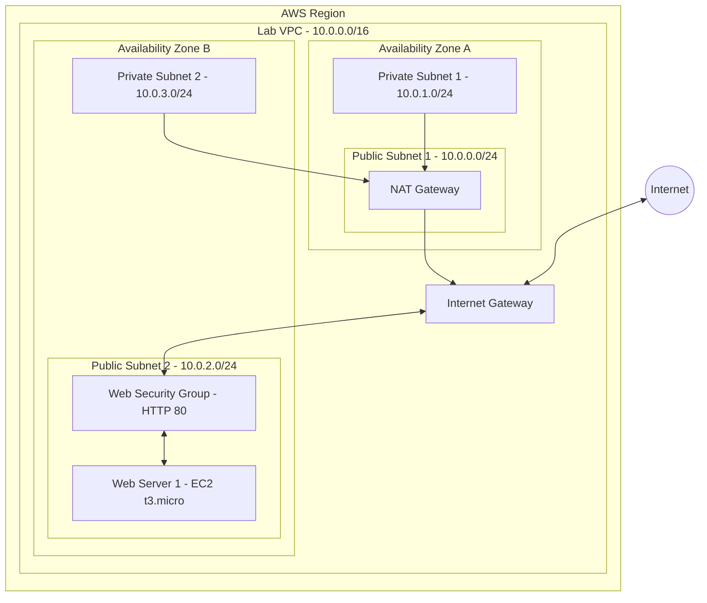

# Criação de uma VPC e implantação de um servidor web na AWS

> **Laboratório:** Build Your VPC and Launch a Web Server  
> **Programa:** AWS re/Start — Escola da Nuvem  
> **Duração estimada:** 45 minutos  
> **Serviços principais:** Amazon VPC, Amazon EC2, Internet Gateway, NAT Gateway e Security Groups

## Visão geral

Este laboratório demonstra a criação de uma rede virtual personalizada na AWS e a implantação de um servidor web acessível pela internet.

A arquitetura utiliza uma VPC com quatro sub-redes distribuídas entre duas Zonas de Disponibilidade (Availability Zones), tabelas de rotas públicas e privadas, um Internet Gateway, um NAT Gateway e um grupo de segurança para controlar o acesso HTTP.

Ao final, uma instância Amazon EC2 executa um servidor Apache com uma aplicação de exemplo instalada automaticamente por meio de **User Data**.

## Objetivos

- Criar uma VPC com endereçamento IPv4 próprio.
- Distribuir sub-redes públicas e privadas em duas Zonas de Disponibilidade.
- Configurar o roteamento com Internet Gateway e NAT Gateway.
- Criar um Security Group para permitir acesso HTTP ao servidor.
- Provisionar uma instância EC2 com Amazon Linux 2.
- Automatizar a instalação e a inicialização do servidor web.
- Validar o acesso público à aplicação pelo navegador.

## Arquitetura da solução



O diagrama representa o fluxo lógico do tráfego na VPC.

O Internet Gateway é associado à VPC, enquanto o NAT Gateway é provisionado em uma sub-rede pública.

### Planejamento de rede

| Recurso | Nome | CIDR / Configuração | Localização |
|---|---|---|---|
| VPC | Lab VPC | 10.0.0.0/16 | Região AWS |
| Sub-rede pública 1 | Public Subnet 1 | 10.0.0.0/24 | AZ A |
| Sub-rede privada 1 | Private Subnet 1 | 10.0.1.0/24 | AZ A |
| Sub-rede pública 2 | Public Subnet 2 | 10.0.2.0/24 | AZ B |
| Sub-rede privada 2 | Private Subnet 2 | 10.0.3.0/24 | AZ B |
| Internet Gateway | IGW da VPC | Acesso à internet | VPC |
| NAT Gateway | NAT Gateway | Saída à internet das sub-redes privadas | AZ A |
| Instância EC2 | Web Server 1 | t3.micro / Amazon Linux 2 | Public Subnet 2 |

### Tabelas de rotas

**Public Route Table**

Associada às duas sub-redes públicas:

| Destino | Target |
|---|---|
| 10.0.0.0/16 | local |
| 0.0.0.0/0 | Internet Gateway |

**Private Route Table**

Associada às duas sub-redes privadas:

| Destino | Target |
|---|---|
| 10.0.0.0/16 | local |
| 0.0.0.0/0 | NAT Gateway |

As sub-redes públicas possuem uma rota padrão para o Internet Gateway, permitindo a comunicação com a internet quando os recursos possuem endereçamento e regras de segurança adequados.

As sub-redes privadas utilizam o NAT Gateway para iniciar conexões de saída, sem permitir que conexões externas sejam iniciadas diretamente pela internet.

## Procedimento

### 1. Criar a VPC

No console **Amazon VPC**:

1. Crie uma VPC denominada `Lab VPC`.
2. Defina o bloco IPv4 como `10.0.0.0/16`.
3. Confirme o identificador da VPC e a Região selecionada.

### 2. Criar as sub-redes e os gateways

1. Crie as quatro sub-redes indicadas na tabela de planejamento.
2. Distribua as sub-redes entre duas Zonas de Disponibilidade.
3. Crie um **Internet Gateway** e associe-o à `Lab VPC`.
4. Crie um **NAT Gateway público** na `Public Subnet 1`, associando um Elastic IP.

> Uma sub-rede não é considerada pública apenas pelo nome. Ela precisa estar associada a uma tabela de rotas que encaminhe o tráfego destinado à internet para um Internet Gateway.

### 3. Configurar as tabelas de rotas

1. Crie a `Public Route Table` na `Lab VPC`.
2. Adicione a rota `0.0.0.0/0` apontando para o Internet Gateway.
3. Associe a tabela às sub-redes `Public Subnet 1` e `Public Subnet 2`.
4. Crie a `Private Route Table` na `Lab VPC`.
5. Adicione a rota `0.0.0.0/0` apontando para o NAT Gateway.
6. Associe a tabela às sub-redes `Private Subnet 1` e `Private Subnet 2`.
7. Confirme a existência da rota `10.0.0.0/16 → local` em ambas as tabelas.

### 4. Criar o Security Group

Acesse **Amazon VPC > Security Groups > Create security group**.

Configure os seguintes parâmetros:

| Campo | Valor |
|---|---|
| Security Group Name | Web Security Group |
| Description | Enable HTTP access |
| VPC | Lab VPC |
| Type | HTTP |
| Protocol | TCP |
| Port | 80 |
| Source | Anywhere IPv4 (0.0.0.0/0) |
| Rule Description | Permit web requests |

Após configurar a regra de entrada, selecione **Create security group**.

O Security Group funcionará como firewall virtual da instância EC2, permitindo conexões HTTP pela porta TCP 80.

> A regra HTTP aberta para qualquer endereço IPv4 é utilizada para fins didáticos. Em produção, recomenda-se adotar HTTPS e aplicar controles de acesso adequados.

### 5. Provisionar a instância EC2

Acesse **Amazon EC2 > Instances > Launch instances**.

Configure os seguintes parâmetros:

| Configuração | Valor |
|---|---|
| Name | Web Server 1 |
| AMI | Amazon Linux 2 AMI (HVM) |
| Instance Type | t3.micro |
| Key Pair | vockey |
| VPC | Lab VPC |
| Subnet | Public Subnet 2 |
| Auto-assign Public IP | Enable |
| Security Group | Web Security Group |

Em **Advanced details > User data**, insira o seguinte script:

```bash
#!/bin/bash

# Instalar Apache e PHP
yum install -y httpd mysql php

# Baixar os arquivos da aplicação
wget https://aws-tc-largeobjects.s3.us-west-2.amazonaws.com/CUR-TF-100-RESTRT-1/267-lab-NF-build-vpc-web-server/s3/lab-app.zip

# Extrair a aplicação
unzip lab-app.zip -d /var/www/html/

# Habilitar e iniciar o servidor web
chkconfig httpd on
service httpd start
```

O script realiza automaticamente as seguintes atividades:

1. Instala o Apache HTTP Server, PHP e os pacotes definidos pelo laboratório.
2. Obtém a aplicação web disponibilizada no Amazon S3.
3. Extrai os arquivos para o diretório `/var/www/html/`.
4. Habilita o Apache para inicialização automática.
5. Inicia o serviço HTTP.

Após adicionar o script, selecione **Launch instance**.

### 6. Validar o funcionamento

1. Acesse **EC2 > Instances**.
2. Localize a instância `Web Server 1`.
3. Aguarde até que apresente **2/2 status checks passed**.
4. Selecione a instância e acesse a aba **Details**.
5. Copie o valor de **Public IPv4 DNS**.
6. Abra uma nova aba no navegador.
7. Acesse o endereço HTTP da instância.

Exemplo:

```text
http://<PUBLIC_IPV4_DNS>
```

Substitua `<PUBLIC_IPV4_DNS>` pelo DNS público fornecido pela AWS.

**Resultado esperado:** a aplicação web deve ser apresentada no navegador, exibindo informações como:

- ID da instância EC2.
- Zona de Disponibilidade.
- Indicador de utilização da CPU.
- Interface web disponibilizada pelo laboratório.

O acesso bem-sucedido confirma o funcionamento do servidor web, do Security Group e do roteamento público.

## Verificações e solução de problemas

Caso o acesso ao servidor não funcione, verifique os seguintes componentes.

### Instância EC2

- A instância está no estado `running`.
- As verificações de status foram concluídas.
- Existe um endereço IPv4 público associado.
- O User Data foi executado corretamente.

### Security Group

Confirme a existência da regra:

| Type | Protocol | Port | Source |
|---|---|---|---|
| HTTP | TCP | 80 | 0.0.0.0/0 |

### Tabela de rotas

Confirme que a `Public Subnet 2` está associada à tabela pública e que existe a rota:

```text
0.0.0.0/0 → Internet Gateway
```

### Servidor Apache

Se houver acesso administrativo à instância, execute:

```bash
sudo systemctl status httpd
```

Para consultar os logs de inicialização:

```bash
sudo tail -n 100 /var/log/cloud-init-output.log
```

Para verificar a resposta HTTP local:

```bash
curl -I http://localhost
```

> O resultado `2/2 checks passed` confirma a saúde básica da instância, mas não garante que a aplicação web tenha sido instalada corretamente.

## Aprendizados

Este laboratório permite compreender os seguintes conceitos:

| Serviço / Componente | Função |
|---|---|
| Amazon VPC | Criação de uma rede virtual logicamente isolada |
| Subnet | Segmentação da VPC em redes menores |
| Availability Zone | Isolamento físico de infraestrutura dentro de uma Região |
| Internet Gateway | Conectividade entre a VPC e a internet |
| NAT Gateway | Acesso de saída à internet para recursos privados |
| Route Table | Definição do encaminhamento do tráfego |
| Security Group | Firewall virtual stateful |
| Amazon EC2 | Provisionamento de instâncias de computação |
| User Data | Automação da configuração inicial da instância |

### Considerações sobre alta disponibilidade

Apesar de a arquitetura utilizar duas Zonas de Disponibilidade, o laboratório não implementa alta disponibilidade completa.

A solução possui:

- Uma única instância EC2 executando a aplicação.
- Um único NAT Gateway localizado na Zona de Disponibilidade A.
- Ausência de balanceamento de carga entre múltiplas instâncias.

Em um ambiente de produção, a arquitetura poderia ser aprimorada com:

- Application Load Balancer (ALB).
- Auto Scaling Group distribuído em múltiplas AZs.
- NAT Gateways independentes por Zona de Disponibilidade.
- HTTPS com AWS Certificate Manager.
- Monitoramento utilizando Amazon CloudWatch.
- Infraestrutura como código utilizando Terraform ou AWS CloudFormation.

## Encerramento e custos

Após a conclusão do laboratório, os recursos utilizados devem ser removidos quando não forem mais necessários.

Verifique especialmente:

- Instância Amazon EC2.
- NAT Gateway.
- Elastic IP.
- Security Groups criados.
- Tabelas de rotas.
- Sub-redes.
- Internet Gateway.
- VPC.

O NAT Gateway e os endereços IPv4 públicos podem gerar cobranças enquanto estiverem provisionados, dependendo das condições da conta e do laboratório.

A exclusão deve respeitar as dependências entre os recursos e as orientações do ambiente AWS re/Start.

---

Este laboratório integra as atividades práticas do **AWS re/Start**, programa de formação em computação em nuvem realizado em parceria com a **Escola da Nuvem**.
