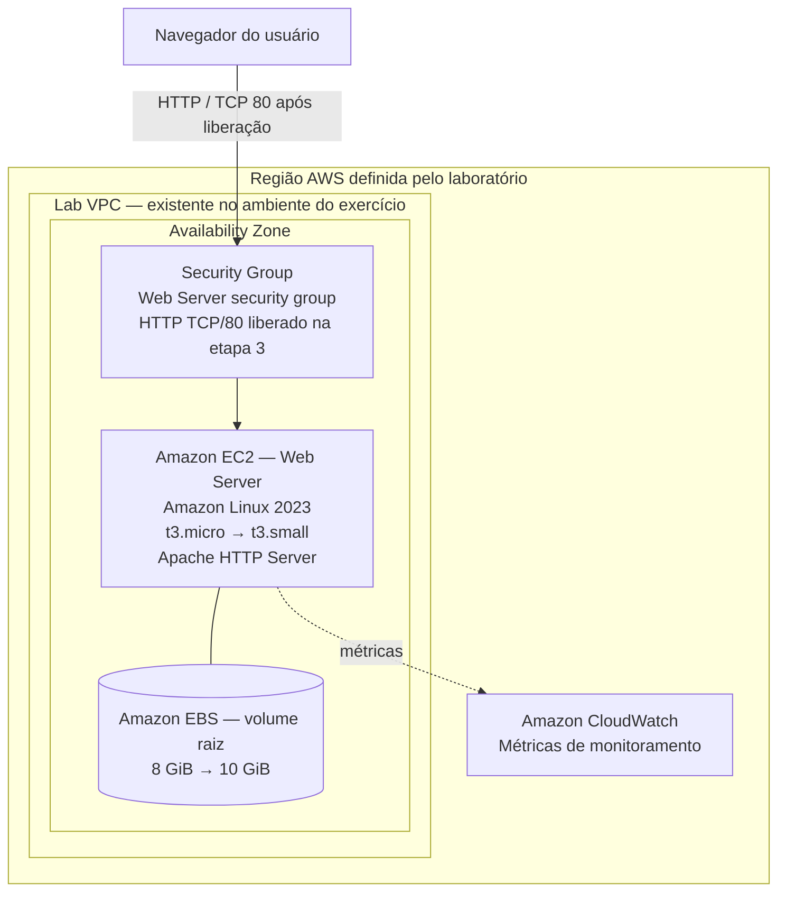

# Lab 011 — Introdução ao Amazon EC2

## Visão geral

Este laboratório apresenta o ciclo de vida básico de uma instância do **Amazon Elastic Compute Cloud (EC2)**: provisionamento, configuração inicial, monitoramento, liberação de acesso a uma aplicação web, redimensionamento e encerramento controlado.

Uma instância Linux será utilizada para hospedar uma página HTML simples, servida pelo **Apache HTTP Server**. A aplicação será configurada automaticamente na inicialização da instância por meio de um script de **User Data**.

| Informação | Descrição |
|---|---|
| Programa | AWS re/Start — Escola da Nuvem |
| Laboratório | Introdução ao Amazon EC2 |
| Identificador | Lab 011 |
| Duração estimada no roteiro | 45 minutos |
| Ambiente | AWS Management Console, com recursos disponibilizados pelo laboratório |
| Serviços e recursos | Amazon EC2, Amazon EBS, Amazon VPC, Security Groups e Amazon CloudWatch |

### Objetivos

Ao final das atividades, será possível compreender como:

1. Criar uma instância EC2 a partir de uma AMI e configurar sua inicialização.
2. Automatizar a instalação e a ativação de um servidor web com User Data.
3. Avaliar a integridade e as métricas básicas da instância.
4. Controlar o tráfego de entrada por meio de um Security Group.
5. Alterar a capacidade computacional e o tamanho de um volume EBS.
6. Habilitar, testar e desabilitar a proteção contra encerramento.
7. Encerrar a instância e verificar a remoção dos recursos associados.

## Arquitetura

O ambiente utiliza uma **VPC previamente preparada pelo laboratório**, uma instância EC2 em uma zona de disponibilidade e um Security Group para controlar a entrada de conexões. A instância possui um volume EBS raiz e executa o Apache na porta 80.



**Leitura do diagrama:** o Security Group controla o acesso de entrada à instância. Na configuração inicial, a porta 80 ainda não está liberada. Na terceira atividade, uma regra HTTP permite acessar a página de teste pelo endereço IPv4 público da EC2. A representação é lógica: o Security Group está associado à interface de rede da instância, não é um equipamento de rede independente.

Há uma descrição ampliada em [docs/arquitetura.md](docs/arquitetura.md).

## Pré-requisitos e características do ambiente

- Acesso à **AWS Management Console** disponibilizada pelo exercício.
- Permissões do laboratório para criar e modificar instâncias EC2, Security Groups e volumes EBS.
- Disponibilidade da **`Lab VPC`**, provisionada previamente no ambiente orientado.
- Acesso a um navegador para testar a resposta HTTP da instância.

> **Ambiente de treinamento:** no AWS re/Start/Vocareum, inicie a sessão em **Start Lab**, aguarde o indicador de disponibilidade ficar verde e abra o console pelo acesso do laboratório. **Não altere a região** sem orientação do roteiro. Se o exercício for reproduzido em uma conta AWS pessoal, a `Lab VPC` poderá não existir e será necessário escolher ou preparar uma VPC/sub-rede com conectividade adequada. Os nomes e as permissões podem variar.

## 1. Provisionar a instância EC2

No console, acesse **EC2 → Instances → Launch instances** e configure os parâmetros abaixo.

| Parâmetro | Configuração do laboratório | Finalidade |
|---|---|---|
| Nome | `Web Server` | Identificação da instância por tag `Name` |
| AMI | Amazon Linux 2023 | Sistema operacional da instância |
| Tipo da instância | `t3.micro` | Configuração inicial: 2 vCPU e 1 GiB de memória |
| Key pair | `Proceed without a key pair` | O roteiro não exige conexão SSH à instância |
| VPC | `Lab VPC` | Rede virtual disponibilizada pelo laboratório |
| Security Group | `Web Server security group` | Controle de acesso à instância |
| Descrição do SG | `Security group for my web server` | Documentação da finalidade do grupo |
| Regras de entrada | Remover a regra SSH sugerida; não adicionar HTTP ainda | Testar o bloqueio de acesso antes da liberação |
| EBS raiz | 8 GiB (configuração padrão indicada no roteiro) | Armazenamento do sistema operacional |
| Termination protection | `Enable` | Evitar encerramento acidental durante os testes |

### Configuração automatizada com User Data

Em **Advanced details → User data**, insira o conteúdo do arquivo [`scripts/user-data.sh`](scripts/user-data.sh):

```bash
#!/bin/bash
yum -y install httpd
systemctl enable httpd
systemctl start httpd
echo '<html><h1>Hello From Your Web Server!</h1></html>' > /var/www/html/index.html
```

O script instala o Apache (`httpd`), habilita sua inicialização durante o boot, inicia o serviço e cria uma página HTML em `/var/www/html/index.html`.

Após revisar a configuração, selecione **Launch instance** e abra a listagem de instâncias.

**Validação:** aguarde a mudança do estado `pending` para `running` e verifique se os **Status checks** chegam a **2/2 checks passed**. Consulte também as abas **Details**, **Security** e **Networking**.

## 2. Monitorar a instância

Com a instância selecionada, examine os recursos de diagnóstico disponíveis no console EC2:

1. **Status checks:** verifique os resultados de **System reachability** e **Instance reachability**.
2. **Monitoring:** observe os gráficos de métricas disponibilizados pelo Amazon CloudWatch. O monitoramento básico disponibiliza métricas com granularidade padrão de cinco minutos; uma instância recém-criada pode apresentar poucos dados.
3. **Actions → Monitor and troubleshoot → Get instance screenshot:** visualize uma captura da tela do console virtual da instância.

Os verificadores de integridade ajudam a distinguir problemas de infraestrutura física/subjacente daqueles relacionados à própria instância. Já o CloudWatch permite acompanhar indicadores operacionais ao longo do tempo.

**Validação:** ambos os verificadores de status aprovados, gráficos de monitoramento acessíveis e captura do console obtida pelo painel EC2.

## 3. Configurar o Security Group e acessar a aplicação

### 3.1. Verificar o bloqueio inicial

1. Copie o **Public IPv4 address** em **EC2 → Instances → Details**.
2. Abra `http://<IP-PUBLICO-DA-INSTANCIA>` no navegador.
3. Observe que, no cenário do laboratório, o acesso HTTP ainda não é permitido pelo Security Group.

O servidor web foi configurado pelo User Data, mas o tráfego de entrada na **porta TCP 80** ainda não foi autorizado.

### 3.2. Liberar HTTP

Acesse **EC2 → Security Groups**, selecione `Web Server security group` e vá até **Inbound rules → Edit inbound rules → Add rule**.

| Campo | Valor |
|---|---|
| Type | `HTTP` |
| Protocol | `TCP` |
| Port range | `80` |
| Source | `Anywhere-IPv4` (`0.0.0.0/0`) |

Salve a regra e atualize a página do navegador.

**Resultado esperado:**

```text
Hello From Your Web Server!
```

**Interpretação:** a aplicação não precisou ser reinstalada. A mudança ocorreu na política de rede associada à instância. Para este exercício, o HTTP é exposto publicamente; em ambientes de produção, o recomendado é utilizar HTTPS e restringir acessos conforme a necessidade.

## 4. Redimensionar a instância e o armazenamento

A atividade demonstra a diferença entre **capacidade computacional** (tipo de instância) e **capacidade de armazenamento** (volume EBS).

### 4.1. Parar a instância

No console EC2, selecione `Web Server` e escolha **Instance state → Stop instance**. Confirme e aguarde o estado `stopped`.

A instância deve estar parada para a troca do tipo descrita neste roteiro. **Parar** não equivale a **encerrar**: a instância poderá ser iniciada novamente, enquanto o volume EBS permanece associado e pode continuar gerando custos.

### 4.2. Alterar o tipo da instância

Com a instância parada, acesse **Actions → Instance settings → Change instance type** e altere de `t3.micro` para **`t3.small`**.

| Recurso | Antes | Depois |
|---|---|---|
| Tipo | `t3.micro` | `t3.small` |
| vCPU | 2 | 2 |
| Memória | 1 GiB | 2 GiB |

A disponibilidade do tipo `t3.small` pode estar sujeita às restrições da conta de treinamento.

### 4.3. Aumentar o volume EBS

1. Abra **EC2 → Elastic Block Store → Volumes**.
2. Identifique o volume raiz associado à instância `Web Server`.
3. Selecione **Actions → Modify volume**.
4. Altere a capacidade de **8 GiB para 10 GiB** e confirme.

**Observação técnica:** aumentar o tamanho do volume no console **não garante, por si só, que a partição e o sistema de arquivos dentro do Linux já utilizem o espaço adicional**. Essa ampliação interna não integra as tarefas exigidas no roteiro fornecido. Em ambientes reais, valide o sistema de arquivos e siga a documentação da AWS para estendê-lo, quando necessário.

### 4.4. Iniciar e validar

Em **EC2 → Instances**, selecione `Web Server` e escolha **Instance state → Start instance**.

Verifique novamente:

- Estado `running` e verificações de status aprovadas.
- Tipo de instância `t3.small`.
- Volume EBS com capacidade configurada de 10 GiB.
- Resposta da aplicação HTTP após a inicialização.

**Atenção:** ao parar e iniciar uma instância sem Elastic IP, o endereço IPv4 público geralmente muda. Consulte novamente o IP no console antes de testar a aplicação.

## 5. Testar a proteção contra encerramento

Esta etapa demonstra o recurso **termination protection**, habilitado durante a criação da instância.

1. Na listagem EC2, selecione `Web Server`.
2. Tente executar **Instance state → Terminate (delete) instance** e confirme a solicitação.
3. Verifique que o encerramento é bloqueado por causa da proteção habilitada.
4. Acesse **Actions → Instance settings → Change termination protection**.
5. Desabilite a opção **Enable** e salve.
6. Execute novamente **Instance state → Terminate (delete) instance** e confirme.

**Resultado esperado:** a tentativa inicial é rejeitada; após a desativação da proteção, a instância pode ser encerrada.

O encerramento é diferente de uma parada temporária: uma instância encerrada não pode ser reiniciada. No comportamento padrão indicado pelo roteiro, o volume EBS raiz é excluído junto com a instância, mas volumes, snapshots ou outros recursos preservados devem ser verificados separadamente.

## Validação técnica consolidada

| Etapa | Verificação | Resultado esperado |
|---|---|---|
| Provisionamento | Instância e verificações de integridade | `running` e `2/2 checks passed` |
| Inicialização | User Data | Apache instalado e página de teste criada |
| Monitoramento | EC2 e CloudWatch | Métricas e screenshot acessíveis |
| Segurança — antes | Navegador em HTTP | Acesso bloqueado pela ausência de regra TCP/80 |
| Segurança — depois | Navegador em HTTP | Mensagem `Hello From Your Web Server!` |
| Redimensionamento | Tipo EC2 | `t3.small` |
| Armazenamento | Volume EBS | 10 GiB configurados no EBS |
| Proteção | Primeira tentativa de encerramento | Operação impedida |
| Encerramento | Tentativa após desabilitar proteção | Instância encerrada |

## Conceitos consolidados

**AMI e tipo de instância.** A AMI define a imagem base do sistema; o tipo da instância define a combinação de CPU, memória e capacidade de rede.

**User Data.** Permite executar tarefas de configuração inicial sem um acesso manual ao sistema operacional. Neste cenário, automatiza a implantação do Apache.

**Security Group.** Atua como firewall virtual associado à interface de rede da instância, controlando o tráfego permitido. A liberação de TCP/80 é indispensável para o teste HTTP descrito neste laboratório.

**Amazon EBS.** O disco raiz permanece associado quando a instância é parada e pode ser redimensionado independentemente do tipo da EC2.

**Monitoramento e verificações de status.** As métricas do CloudWatch e os verificadores do EC2 atendem a finalidades diferentes e complementares.

**Stop e terminate.** Parar preserva a instância para uso posterior; encerrar remove a instância. A proteção contra encerramento oferece uma barreira adicional contra exclusão acidental.

## Resolução de problemas e cuidados

| Situação | O que verificar |
|---|---|
| Não é possível criar a instância | Permissões do laboratório, região, `Lab VPC`, AMI e tipos de instância permitidos |
| A aplicação não responde antes da liberação | Comportamento esperado: falta uma regra de entrada HTTP/TCP 80 |
| A aplicação não responde após a liberação | IPv4 público atual, Security Group correto, inicialização do Apache, status da instância e conectividade da VPC/sub-rede |
| Acesso HTTP parou após o redimensionamento | Verificar se o IPv4 público mudou ao parar/iniciar |
| Volume EBS mostra 10 GiB, mas o Linux não | Pode ser necessário ampliar partição e sistema de arquivos; atividade complementar não exigida no roteiro |
| Não é possível encerrar a EC2 | Verificar se a proteção contra encerramento continua habilitada |

**Custos:** em uma conta AWS pessoal, EC2, EBS e IPv4 público podem consumir créditos ou gerar cobranças conforme as condições da conta. Após o exercício, verifique instâncias, volumes EBS, snapshots e recursos associados. Não considere uma instância apenas `stopped` como limpeza completa.

## Arquivos deste laboratório

```text
lab-011-introducao-amazon-ec2/
├── README.md
├── docs/
│   └── arquitetura.md
└── scripts/
    └── user-data.sh
```

- [`README.md`](README.md): descrição e execução do exercício.
- [`docs/arquitetura.md`](docs/arquitetura.md): representação e explicação da arquitetura e das regras de acesso.
- [`scripts/user-data.sh`](scripts/user-data.sh): script de instalação e configuração do servidor web.

Para futuras evidências, pode-se acrescentar uma pasta `evidencias/` com imagens da instância, dos verificadores de status e da página HTTP, sem incluir credenciais, identificadores sensíveis ou outros dados do ambiente.

## Referências

- [Amazon EC2 — documentação oficial](https://docs.aws.amazon.com/pt_br/ec2/)
- [Monitoramento das instâncias Amazon EC2](https://docs.aws.amazon.com/AWSEC2/latest/UserGuide/monitoring_ec2.html)
- [Parar e iniciar instâncias EC2](https://docs.aws.amazon.com/pt_br/AWSEC2/latest/UserGuide/Stop_Start.html)
- [Estender o sistema de arquivos após ampliar um volume EBS](https://docs.aws.amazon.com/pt_br/ebs/latest/userguide/recognize-expanded-volume-linux.html)
- [AWS re/Start](https://aws.amazon.com/pt/training/restart/)

---

**Origem do exercício:** conteúdo estruturado a partir do roteiro **Introduction to Amazon EC2**, utilizado na formação AWS re/Start com a Escola da Nuvem. Esta documentação reorganiza as atividades em formato de registro técnico e acrescenta notas explicativas e recomendações de validação; não substitui as instruções e restrições do ambiente oficial de treinamento.
