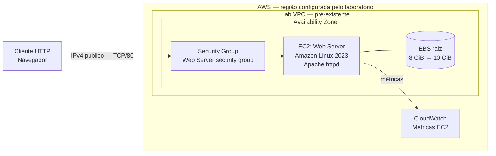
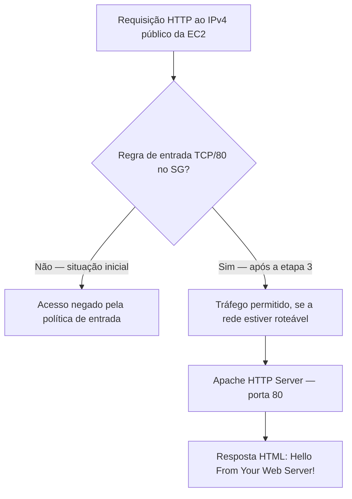
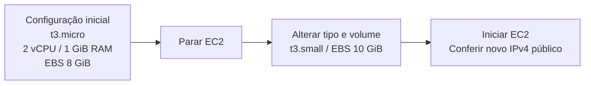
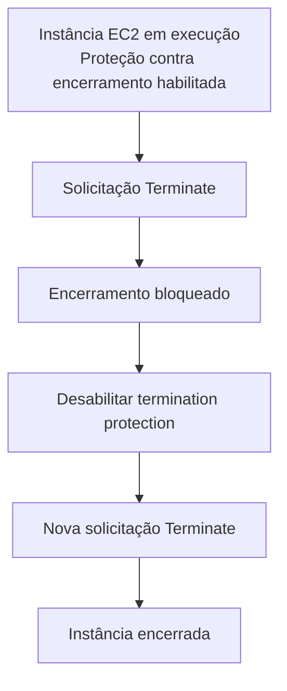

# Arquitetura — Lab 011: Introdução ao Amazon EC2

## Topologia lógica

O diagrama representa a associação lógica entre os componentes. O Security Group não é um equipamento intermediário; suas regras são aplicadas à interface de rede vinculada à instância EC2. A VPC já está disponibilizada no ambiente do treinamento e o roteiro não especifica os detalhes de suas sub-redes ou rotas.

## Fluxo de acesso HTTP

A regra de entrada definida no exercício é:

| Parâmetro | Valor |
|---|---|
| Security Group | `Web Server security group` |
| Direção | Inbound |
| Protocolo | TCP |
| Porta | 80 |
| Origem | `0.0.0.0/0` (`Anywhere-IPv4`) |
| SSH | Sem regra de entrada SSH no roteiro |

> A presença da regra HTTP não resolve, sozinha, problemas de roteamento, endereçamento público ou inicialização do servidor. O roteiro pressupõe conectividade adequada da infraestrutura pré-configurada.

## Evolução da capacidade

O redimensionamento do volume EBS e a ampliação da partição e do sistema de arquivos do Linux são operações distintas. A ampliação interna não é solicitada no roteiro de treinamento fornecido.

## Proteção e descarte

## Limites e suposições

- O laboratório apresenta **uma única instância EC2** em **uma Availability Zone**; não configura balanceamento de carga nem alta disponibilidade.
- A `Lab VPC` é pressuposta como existente. A criação da VPC, sub-rede e gateway não faz parte deste roteiro.
- O acesso à página ocorre por HTTP com IPv4 público, após a liberação do Security Group.
- O disco raiz EBS inicia com 8 GiB e é configurado para 10 GiB.
- A instância é lançada sem key pair porque **não há atividade de acesso SSH**.
- O monitoramento apresentado utiliza as verificações nativas de status do EC2 e métricas do CloudWatch.

[Voltar ao README do laboratório](../README.md)
